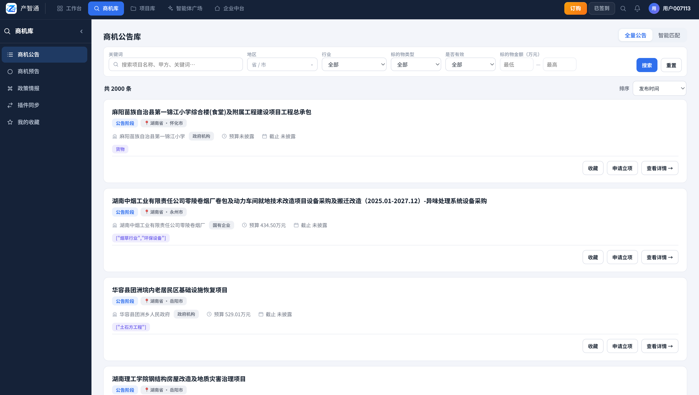
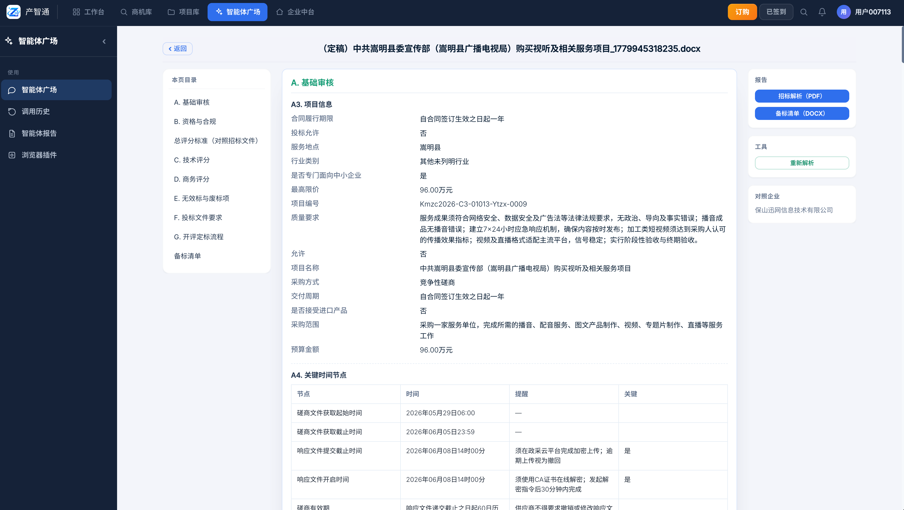
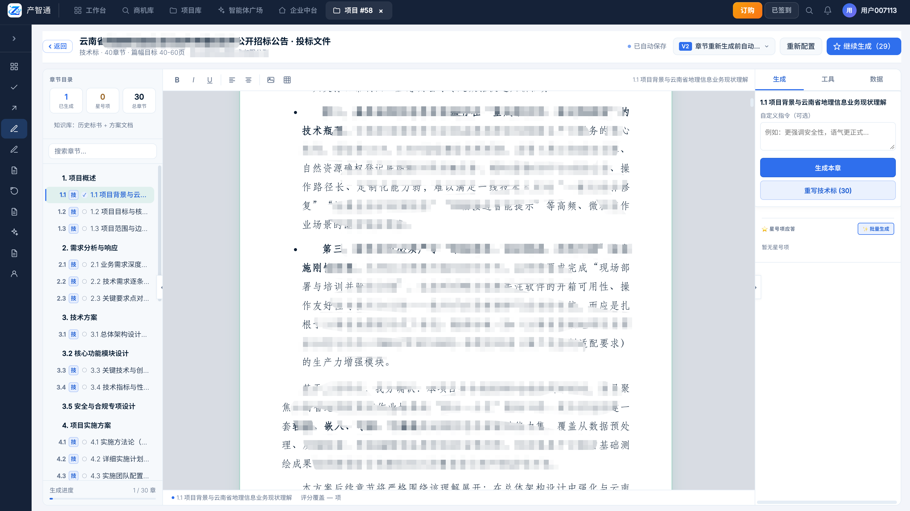
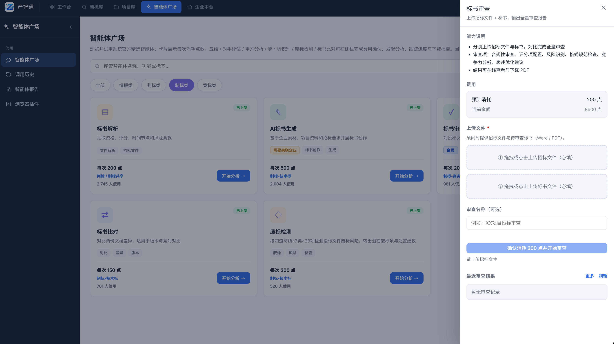
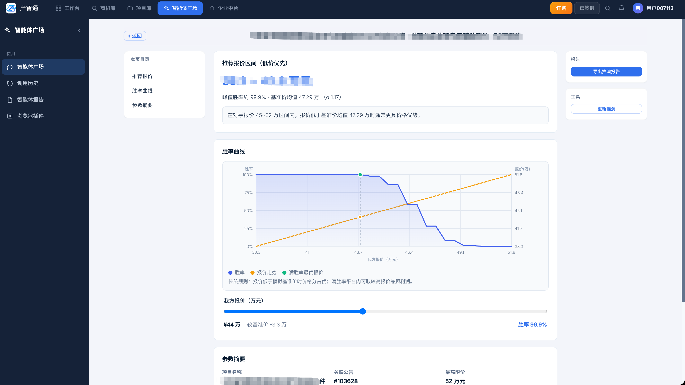
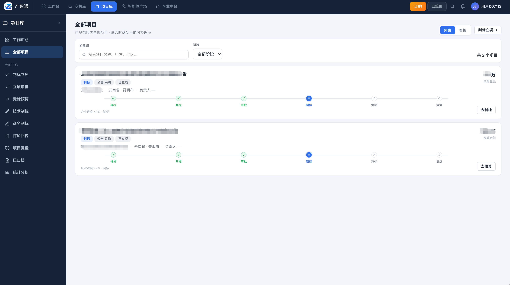
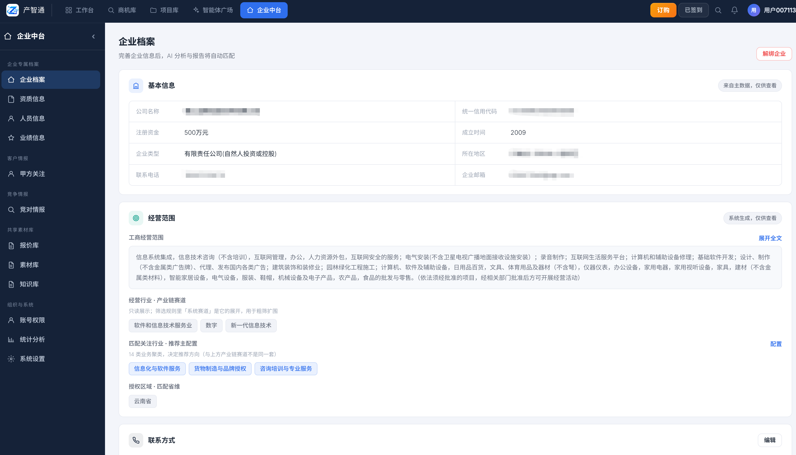

# 产智通 · AI 投标助手 & Agent Skills

从招标信息筛选，到标书响应、报价分析与结果复盘，让每一步都有依据、有交付物。

[在线体验产智通](https://www.chanzhitong.com/) · [免费使用 Skills](skills/README.md) · [完整示例](examples/项目初筛示例.md) · [产品截图](SCREENSHOTS.md) · [API / MCP 规划](ROADMAP.md)

> 这是产智通商业产品的介绍与公开工具包仓库。商业系统源码不在本仓库开放；这里的简易 Skills、模板和虚构案例可以独立使用，无需注册产智通。商业版功能、价格和可用范围以网站实际展示为准。

## 先带走一套能用的投标工具

不注册也可以使用本仓库的 **6 个轻量 Skills、投标响应矩阵和完整初筛案例**。适合投标经理、售前方案人员和希望给自己的 Agent 加入投标流程的开发者。

| 你现在要做什么 | 直接使用 | 得到什么 |
| --- | --- | --- |
| 从招标公告里挑项目 | [项目初筛](skills/bid-opportunity-screen/SKILL.md) | 匹配依据、阻碍与待核实项 |
| 决定投不投 | [投标决策](skills/bid-go-no-go/SKILL.md) | 条件检查与参与建议 |
| 拆解招标文件与评分项 | [响应矩阵](skills/bid-response-matrix/SKILL.md) | 条款—章节—证据对应表 |
| 起草技术标、商务标章节 | [章节起草与自查](skills/bid-draft-review/SKILL.md) | 有事实依据的草稿与缺口 |
| 比较报价情景 | [报价分析](skills/bid-quote-scenarios/SKILL.md) | 成本、利润及约束对照 |
| 让下一次投标有所改进 | [结果复盘](skills/bid-win-loss-review/SKILL.md) | 可验证的改进任务 |

先看[完整输入与输出示例](examples/项目初筛示例.md)，或直接复制[投标响应矩阵模板](templates/投标响应矩阵.md)。

### 怎么交给自己的 Agent 使用？

下载所需 Skill 文件夹，按客户端支持的方式加载 `SKILL.md`；不支持 Skills 的对话工具也可以直接粘贴正文。

```text
请读取我提供的 bid-response-matrix/SKILL.md，
根据随后提供的脱敏招标文件整理投标响应矩阵。
每条要求保留页码或章节号；缺少的企业材料标为待补，不能编造。
先告诉我现有材料的覆盖范围，再开始分析。
```

这些公开 Skill 只依赖你提供的材料与所用 AI 工具，不需要产智通 API Key。模型平台可能收取其自身的使用费用。

### 仓库里有什么？

```text
README.md         产品介绍与使用入口
skills/           6 个独立的公开简易 Skills
examples/         虚构项目的输入与参考输出
templates/        可直接填写的投标响应矩阵
SCREENSHOTS.md    产品界面与历史功能局部截图
ROADMAP.md        API / MCP 开放能力规划
assets/           截图与微信联系方式
```

## 从单次分析，到持续的投标工作

找到了招标公告，却不知道是否值得投入；读完招标文件，仍怕遗漏资格条件与评分项；标书写了很多，交付证据与评分要求却没有一一对应；项目结束后，又只留下“中了或没中”的结论。

产智通用“寻标 → 判标 → 制标 → 竞标 → 复盘”组织投标工作，把零散材料转成可执行的判断、响应任务和经验积累。

## 投标五步法与智能体分工

下表是产品能力方向及公开工具的对应关系，不代表公开版包含商业系统全部能力。公开版以用户提供的材料为输入，不自带标讯数据和企业知识库。

| 步骤 | 商业产品能力方向 | 本仓库可用的简易智能体 / Skill | 交付物 |
| --- | --- | --- | --- |
| 寻标 | 项目初筛、寻标能力诊断、政策情报 | [项目初筛](skills/bid-opportunity-screen/SKILL.md) | 匹配项、阻碍与核实清单 |
| 判标 | 五维决策、甲方与竞对情报辅助 | [投标决策](skills/bid-go-no-go/SKILL.md) | 有证据的参与建议 |
| 制标 | 标书解析、知识库辅助创作与审查 | [响应矩阵](skills/bid-response-matrix/SKILL.md)、[章节起草与自查](skills/bid-draft-review/SKILL.md) | 条款到章节、材料的对应表 |
| 竞标 | 报价推演与质疑分析辅助 | [报价情景分析](skills/bid-quote-scenarios/SKILL.md) | 候选报价与成本利润分析 |
| 复盘 | 结果归因与经验沉淀 | [结果复盘](skills/bid-win-loss-review/SKILL.md) | 可验证的改进任务 |

公开 Skills 是轻量文本流程，适合先理解方法并处理单次材料。商业产品面向持续的项目管理、数据与知识库协作；具体上线情况请在网站体验确认。我们不承诺中标率，也不以 AI 结论代替团队决策。

## 看看实际界面

以下按当前提供的截图展示操作流程与结果形态，部分业务信息已遮挡。截图费用与权限以站内当前说明为准；报告与模拟结果需要人工复核。

**商机公告库**

按关键词、地区、行业、标的物类型、有效状态和金额筛选公告，查看项目卡片并进入详情、收藏或申请立项。截图中的条数仅为当时页面展示。



**解析结果：结构化阅读与备标清单**

结果页按基础审核、资格与合规、评分标准、技术评分、商务评分、无效标与废标项、投标文件要求、开评定标流程及备标清单组织内容，并提供招标解析 PDF 与备标清单 DOCX 导出入口。截图仅展示其中部分内容，提取结果仍需对照原文复核。



**标书创作：章节编辑与持续生成**

编辑器展示章节目录、生成进度、版本选择、自定义指令、单章生成与批量生成入口。截图中尚有未生成章节，正文部分已做遮挡，不代表完整标书已经交付。



**标书审查：双文件对照**

在广场侧栏分别上传招标文件和待审查标书，发起合规、评分、风险、格式、竞争力与表述优化等检查，页面提供费用确认和结果查看说明。截图为发起界面。



**博弈推演：报价情景结果**

报告展示报价区间、条件模拟胜率曲线、报价滑杆和导出入口。图中胜率仅是在输入假设与评分模型下的模拟结果，不是真实中标概率或中标承诺；报价应结合成本和项目规则独立判断。



**项目库：阶段推进与工作入口**

按关键词和阶段查看项目，以寻标、判标、审批、制标、竞标、复盘进度定位工作，并进入对应办理页面。项目名称、金额等部分内容已由提供者遮挡。



**企业中台：资料统一维护**

集中维护企业档案、资质、人员、业绩，以及报价库、素材库和知识库，为匹配与制标提供资料基础。截图中企业身份与联系方式等部分字段已由提供者遮挡。



[查看全部 14 张截图：操作入口、结果报告与历史功能局部 →](SCREENSHOTS.md)

## 用一次项目初筛跑通流程

1. 打开[项目初筛 Skill](skills/bid-opportunity-screen/SKILL.md)，复制正文到你使用的 AI 对话工具，或按该工具支持的方式加载 `SKILL.md`。
2. 提供脱敏后的公告和企业能力摘要，要求每项判断标注材料出处。
3. 对照[虚构示例](examples/项目初筛示例.md)检查结果，用[响应矩阵模板](templates/投标响应矩阵.md)继续整理条款。

不同 AI 工具对 Skills 的加载方式不同；这些文件不包含可执行程序，也不会自动连接产智通。

## 后续开放能力

计划逐步提供 API 与 MCP，让企业把产智通能力接入自己的智能体。当前仅公布方向，未在本仓库发布可调用接口、服务地址或 SDK，也未承诺上线日期。详见[路线图](ROADMAP.md)。

## 体验与交流

如果你希望把单次分析变成持续的投标工作流程，可以[访问产智通官网](https://www.chanzhitong.com/)了解和试用。可用功能与费用以站内说明为准。

欢迎通过 Issues 提交脱敏后的使用问题、模板建议和 API / MCP 需求。不要上传真实标书、账号凭据或客户资料。

微信联系：网蝶数据。扫码交流产品体验、团队需求与接入场景。


## 使用与贡献

公开文本材料的使用范围见[LICENSE](LICENSE)。商业产品源码、数据、品牌与二维码不随文本材料授权。欢迎贡献通用方法、脱敏案例和纠错，见[贡献说明](CONTRIBUTING.md)。

相关主题：招投标、招标公告、投标决策、AI 标书、招标文件解析、投标文件审查、技术标、商务标、投标报价、投标复盘、Agent Skills、MCP。
