# 产智通产品截图集

[返回首页](README.md)

本页按当前提供的截图更新，包括官网、系统操作与结果页，以及两张历史帮助文档局部图。新增截图的原始拍摄时间未核实；界面、费用和权限以网站当前版本为准。部分业务信息由截图提供者做了遮挡，其余可见内容仅用于说明界面，不表示客户背书或实际投标成果。

## 官网首页

产品定位与模块概览。首页图表属于官网展示内容，不作为客户业绩或中标率证明。

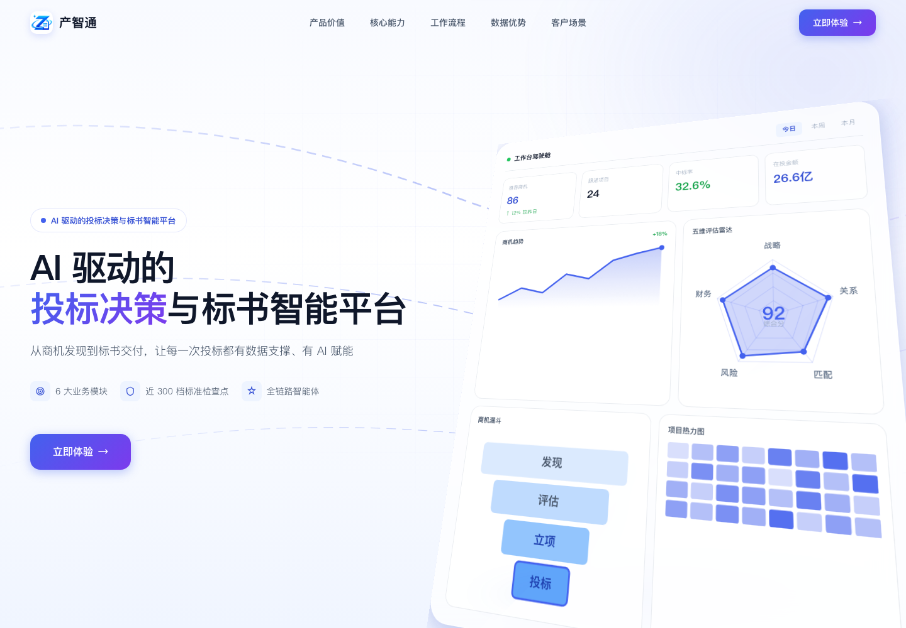

## 投标五步法

围绕寻标、判标、制标、竞标、复盘组织任务与能力。

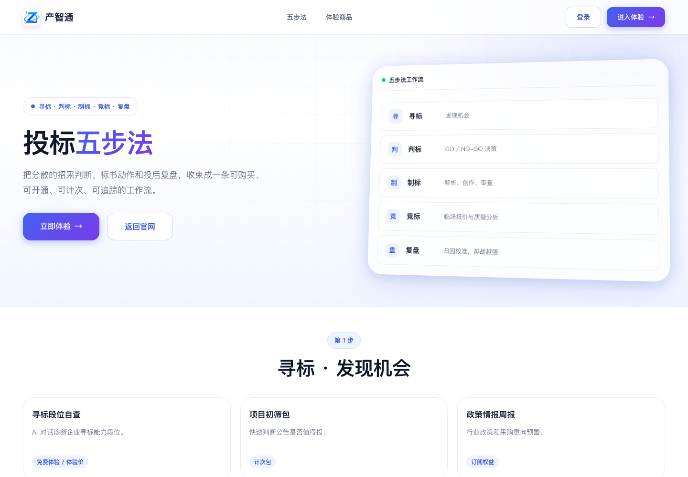

## 智能体广场

按任务类别浏览智能体与调用入口。价格、点数、使用人数与权限以站内当前展示为准。

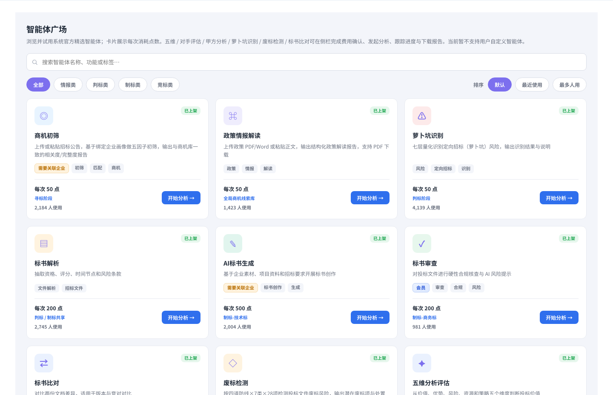

## 商机公告库

按关键词、地区、行业、标的物类型、有效状态和金额筛选公告，查看项目卡片并进入详情、收藏或申请立项。截图中的条数仅为当时页面展示。

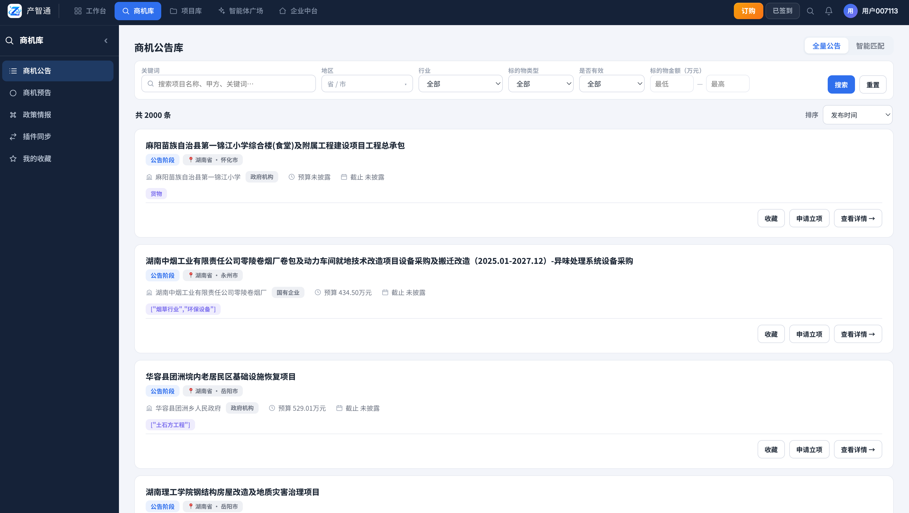

## 标书解析：独立上传

从智能体广场侧栏上传 PDF 或 Word 招标文件，无需关联商机；页面展示能力说明、费用确认和最近解析结果。

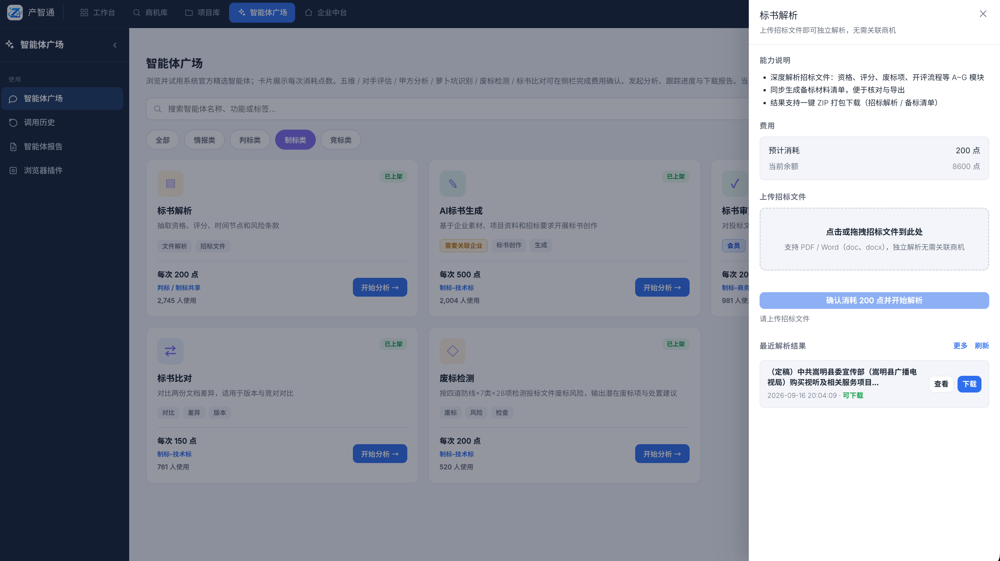

## 解析结果：结构化阅读与备标清单

结果页按基础审核、资格与合规、评分标准、技术评分、商务评分、无效标与废标项、投标文件要求、开评定标流程及备标清单组织内容，并提供招标解析 PDF 与备标清单 DOCX 导出入口。截图仅展示其中部分内容，提取结果仍需对照原文复核。

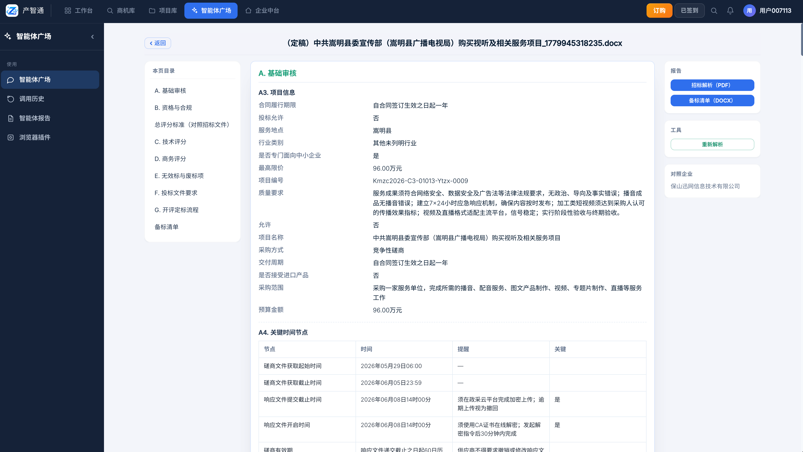

## AI 标书生成：底稿与配置

从广场上传招标文件、填写项目名称，按底稿、配置和目录步骤发起创作；可引用企业公共知识库，生成后进入编辑页继续修改。广场创作为独立工具产出，不会自动进入项目库。

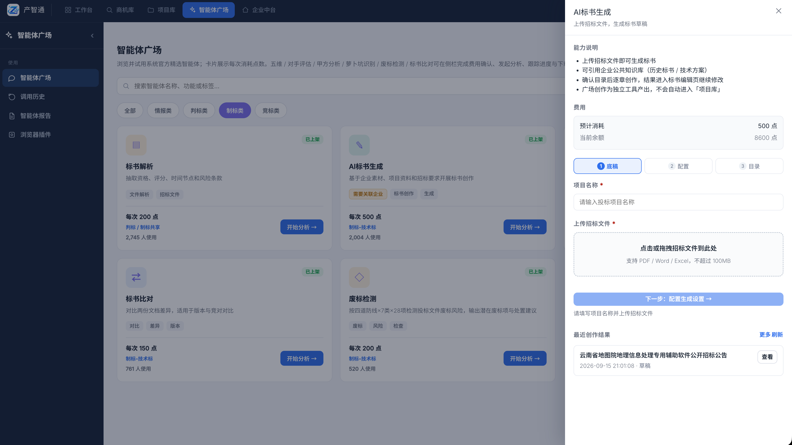

## 标书创作：章节编辑与持续生成

编辑器展示章节目录、生成进度、版本选择、自定义指令、单章生成与批量生成入口。截图中尚有未生成章节，正文部分已做遮挡，不代表完整标书已经交付。

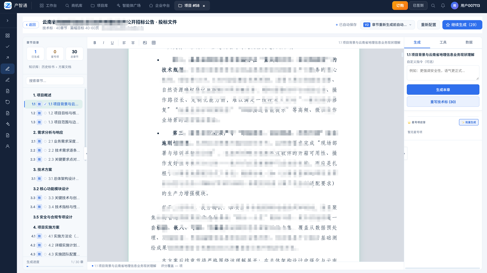

## 标书审查：双文件对照

在广场侧栏分别上传招标文件和待审查标书，发起合规、评分、风险、格式、竞争力与表述优化等检查，页面提供费用确认和结果查看说明。截图为发起界面。

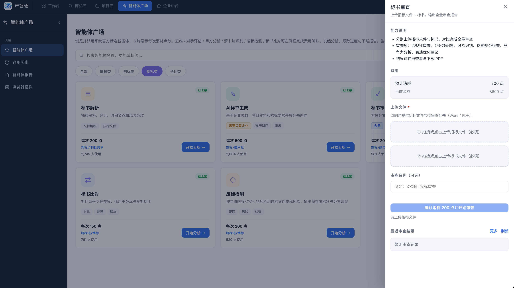

## 博弈推演：报价情景结果

报告展示报价区间、条件模拟胜率曲线、报价滑杆和导出入口。图中胜率仅是在输入假设与评分模型下的模拟结果，不是真实中标概率或中标承诺；报价应结合成本和项目规则独立判断。

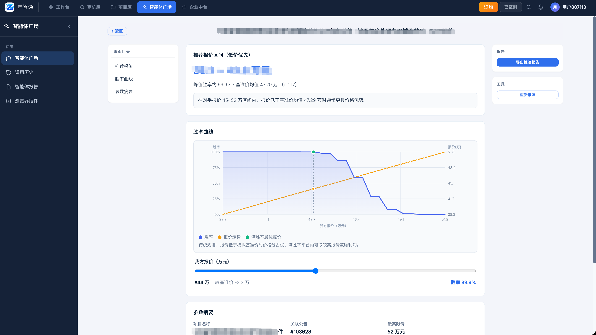

## 项目库：阶段推进与工作入口

按关键词和阶段查看项目，以寻标、判标、审批、制标、竞标、复盘进度定位工作，并进入对应办理页面。项目名称、金额等部分内容已由提供者遮挡。

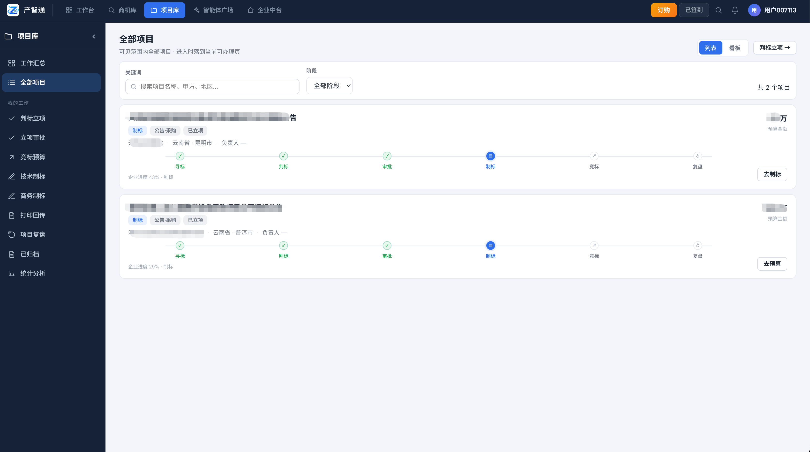

## 企业中台：资料统一维护

集中维护企业档案、资质、人员、业绩，以及报价库、素材库和知识库，为匹配与制标提供资料基础。截图中企业身份与联系方式等部分字段已由提供者遮挡。

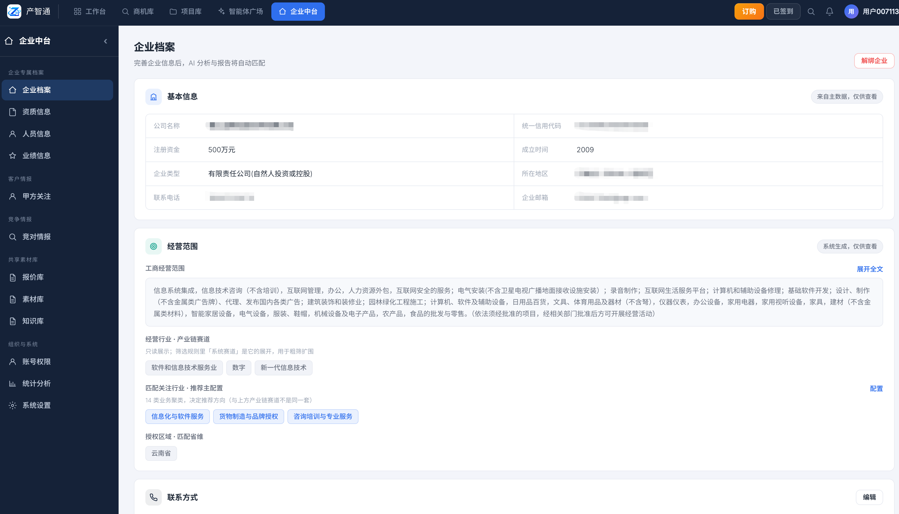

## 历史功能局部：分层复盘

来自项目历史帮助文档，仅保留结果记录与留痕、归因、反哺三个复盘层级。原拍摄日期未核实，可能与当前版本不同。

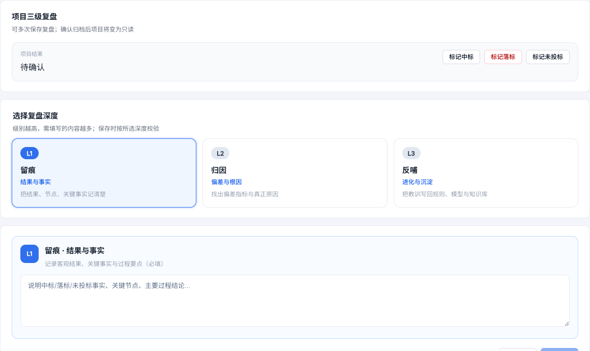

## 历史功能局部：审查问题与修改建议

来自项目历史帮助文档，仅保留问题、原文与修改建议局部。用于说明问题定位方式，不作为完整审查结果或准确率证明。

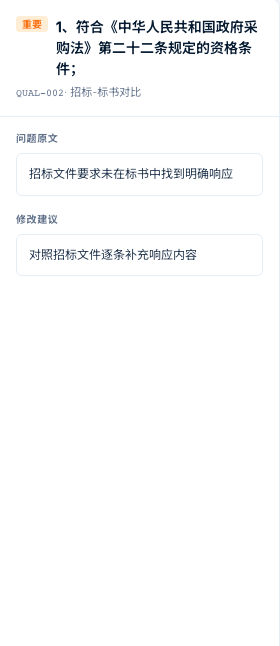

